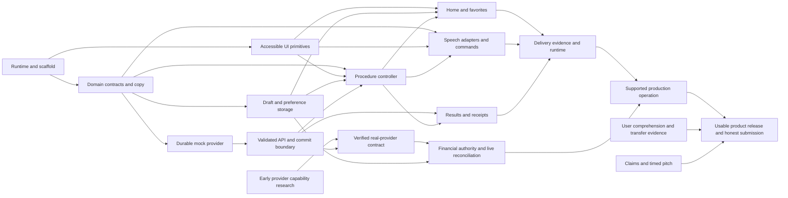

# Autonomía Digital — module action plan

Status: **proposed work; no application modules implemented**. Date: 2026-10-21.

[Architecture, repository links and decisions](ARCHITECTURE.md) · [Product contract](../AGENTS.md) ·
[Spanish team overview](PRODUCTO_EQUIPO.md) · [Hackathon execution](HACKATHON_PLAYBOOK.md)

## Destination and delivery order

Build an accessible digital companion that speaks, listens when invited, and
helps a person complete procedures independently. The user explicitly requires
a **usable product**, with the teammate's home/favorites design, recovery, help,
confirmation, truthful results, provider-supported cancellation, support and voice.
The first operational capability is actual authorized utility-bill payment.
The simulated journey is an internal verification checkpoint; M00–M10 alone do
not fulfill operational bill payment. A second procedure starts only after the
first satisfies its applicable AGENTS.md I1–I10 gates.

The modules below are construction units, not independent release promises.
Scaffolding, a screen, or an open port alone is not a completed product level.
Persistence, authorization, accessibility, and verification enter with the first
module that needs them; none is deferred to a later “hardening” phase.

| Product level | Observable outcome | Completion gate |
| --- | --- | --- |
| L1 — usable guided bill payment | A person starts at home, completes an authorized utility-bill payment, hears/reads help, resumes interruptions, sees a reconciled result/receipt and has truthful cancellation/support paths | R00–R03 plus M00–M14 and all provider/usability/operational gates; the mock checkpoint alone is insufficient |
| L2 — second complete procedure | A chosen appointment OR transport journey works through the same accessible shell and contracts | Start only after L1; document its own provider and authority boundary |
| L3 — broader supported services | Additional complete procedures/providers can be operated and supported without weakening existing invariants | Provider-specific authority, settlement/booking, privacy, support and recovery verified per service |

Do not fill the home with nonfunctional L2/L3 buttons. If time is limited, finish
L1 with its invariants intact rather than presenting incomplete extra journeys.
If actual constraints prevent that, report the unfinished product honestly; do
not relabel a simulation an operational release to meet a presentation deadline.

## Product, evidence and presentation workstreams

The following work starts alongside engineering, not after coding. Details live
in the linked protocols so this plan does not duplicate their source of truth.

| ID | Work package | Deliverable and gate | Timing / dependency |
| --- | --- | --- | --- |
| R00 | Shared product and event constraints | PRODUCT.md, known 3–5-minute pitch, unknown deadline/team/reuse rules assigned to owners | Before discretionary feature work; do independent checks while event facts are pending |
| R01 | Discovery and risky assumptions | E01/E05/E06 in VALIDATION.md: comprehension, real-device voice and actual provider capability | Begin immediately; provider choice and copy depend on observations |
| R02 | Task evidence and iteration | Observed independent/assisted/stopped outcomes, comprehension, second-bill transfer, versioned retest | Early sketch feedback, then actual integrated application; no invented results |
| R03 | Claims, presentation and submission | EVIDENCE_LEDGER.md, timed 3/5-minute script, disclosed fallback, tested artifact links and reuse notices | Draft narrative early; factual claims released only after their evidence exists |

No official judging rubric is assumed. Roles, relative checkpoints and risks are
in HACKATHON_PLAYBOOK.md. There is no fabricated hours estimate while the actual
deadline/team capacity is unknown.

## Dependency map

Checks belong to their modules even though the combined delivery evidence is
collected in M10. Candidate test paths below are to create during implementation,
not tests that already exist or have passed.

## M00 — Reproducible runtime and application shell

**Create:** Next.js/TypeScript scaffold, root layout with `lang="es-AR"`, npm
lockfile, runtime pin, ignored output/data paths, unit/integration/browser test
configuration, and minimal CI wiring. Existing AGENTS.md, skills and taste survive
scaffolding; inspect generator behavior before running it over this checkout.

**Dependencies:** none. Follow ADR-001/002.

**Tasks:** verify compatible Next/React/Node 24 versions; check SQLite native
adapter installation; add only the packages required by the next modules. Confirm
the Node deployment can write a private data directory. Keep dummy data and test
outputs ignored at creation, except intentionally authored synthetic catalog
definitions and migration source.

**Exit evidence:** frozen installation, production build and a real request to
the app shell work in this environment. Record actual commands/version pins in
AGENTS.md after running them. Run one meaningful test of the shell/configuration,
not a zero-test command. If native SQLite fails, resolve ADR-002 before claiming
that operations survive restart.

**Skills:** `git-discipline`, `secure-by-construction`, `falsifiable-testing`.

## M01 — Procedure contracts, synthetic bills and shared es-AR copy

**Create:** `app/flows/contracts.ts`, `registry.ts`, `pago-servicio/`,
`app/lib/copy/es-AR/`, and `money.ts`.

**Depends on:** M00.

**Tasks:** define versioned steps/events/drafts/reviews/results; enumerate one
primary action, help and back/cancel targets for every step. Define a small
synthetic bill catalog with server-owned payee/amount. Store money as integer
centavos with `Intl` formatting. Each copy record provides heading, instruction,
help and result wording consumed by both visual UI and speech.

**Exit evidence:** `tests/unit/procedure-contracts` rejects a step without help,
multiple primary actions, invalid events, invalid amounts, unknown services and
unsupported persisted versions. `tests/unit/money` checks exact ARS formatting and
rounding boundaries. Enumerate all steps to detect dead ends. UI copy review
confirms synthetic/demo labels and understandable confirmations.

**Invariants:** I1, I4, I5, I7, I8, I10.
**Skills:** `secure-by-construction`, `non-overwhelming-ux`, `falsifiable-testing`.

## M02 — Accessible visual primitives and procedure shell

**Create:** cohesive fields/buttons/dialogs in `app/components/ui/`, plus the
procedure shell, help panel, error summary and progress indicator.

**Depends on:** M00; use M01 copy as it becomes available.

**Tasks:** native semantics first; use React Aria for complex behavior. Keep a
field's label/hint/error together. Keep help/back in predictable positions and
focus the new step heading. Use the teammate's large cards and simple hierarchy;
do not introduce a component library's default dashboard layout.

**Exit evidence:** browser tests verify keyboard operation, associated labels,
dialog focus/return and error announcements. Check 44×44 px project targets,
4.5:1 body contrast and 200% zoom manually; run axe on representative states.
Fix a deliberately removed label or broken focus return and show the relevant
check detects it. Later journey steps inherit these checks, not just this shell.

**Invariants:** I5, I6, I7.
**Skills:** `frontend-component-boundaries`, `frontend-accessibility-by-construction`,
`non-overwhelming-ux`, `falsifiable-testing`.

## M03 — Draft, favorites and preference repository

**Create:** `app/lib/persistence/` with Dexie implementation, explicit schema
versions/migrations, and a narrow storage interface.

**Depends on:** M01.

**Tasks:** persist entered values and step IDs, stable draft/attempt IDs and keys,
implemented-task favorites, and speech preferences. Validate on restore. Exclude
audio, transcripts, credentials and card details. Handle IndexedDB denial,
corruption, quota and incompatible versions visibly; retain entered in-memory
values and never falsely say they were saved. Prevent confirmation if its stable
attempt key cannot be persisted. Expose an explicit local-data reset that does
not imply cancelling a server operation.

**Exit evidence:** browser tests reload, close/reopen the page, navigate back and
restore the same values/step. Integration checks exercise migration and failure
paths. Two tabs cannot overwrite a newer draft unnoticed; use draft revisions
and an explicit stale-tab recovery choice. A persisted draft marked “paid” cannot
create a successful result without provider lookup.

**Invariants:** I3, I4, I8, I10.
**Skills:** `secure-by-construction`, `decision-record-discipline`, `falsifiable-testing`.

## M04 — Durable simulated provider and operation ledger

**Create:** `app/providers/contracts.ts`, `mock/` with schema/migrations and
transactional ledger, and `server-factory.ts`.

**Depends on:** M01 and the storage-runtime gate in M00.

**Tasks:** implement server quotes, commit, owned lookup and cancellation using
synthetic bills. Persist owner, request fingerprint, stable attempt/key, revision,
status and cancellation capability. Enforce uniqueness/idempotency atomically.
Provide deterministic succeeded/pending/failed/cancellation scenarios with test
fixtures; never use random outcomes or public arbitrary status overrides. Reject
live credentials/configuration in demo mode.

**Exit evidence:** integration tests use the real SQLite-backed mock, not a stub
that merely returns the expected status. Send concurrent identical requests,
different keys for the same active attempt, conflicting payloads, duplicate
cancellations and cancel/status races. Assert exact ledger rows/status, restart
the provider process and assert the same operation survives. A subsequent lookup
must prove cancellation changed the operation. Removing a unique constraint or
transaction guard must make a relevant test fail.

**Invariants:** I1, I2, I4, I8.
**Skills:** `secure-by-construction`, `decision-record-discipline`, `falsifiable-testing`.

## M05 — Anonymous session, review API and commit boundary

**Create:** `app/lib/server/` and the review/operation route handlers described in
the architecture. `commitProcedure()` is the only financial commit service.

**Depends on:** M01, M04.

**Tasks:** isolate demo sessions without accounts; parse bounded requests and
enforce ownership on every operation route. Add same-origin/CSRF checks and
server confirmation bindings to quote, owner and draft revision. Never accept a
client-supplied amount as authoritative. Replays return the existing operation;
unknown results go through lookup by operation or owned draft/attempt ID.

**Exit evidence:** actual API calls reject missing/stale confirmation, manipulated
amount/payee, another session's operation, oversized or malformed bodies and
cross-origin mutations. A double submit yields one operation. Simulate a dropped
response after commit and recover the same operation. No unguarded route calls
the provider commit directly. Verify invalid requests leave the ledger unchanged.

**Invariants:** I1, I2, I4, I8.
**Skills:** `secure-by-construction`, `falsifiable-testing`.

## M06 — Payment procedure controller and recovery

**Create:** `app/flows/procedure-machine.ts`, payment controller and thin
`app/(flow)/[procedure]/page.tsx` integration.

**Depends on:** M01–M05.

**Tasks:** wire choosing/entering/reviewing/confirming/submitting/result and the
restore/reconcile/cancel/error transitions. Only a user confirmation control
initiates `commitProcedure()`; route entry, effects, restoration and suggestions
cannot do so. Editing reviewed details invalidates confirmation. Keep field-local
state separate from procedure state, and prevent stale/double-tab submissions.

**Exit evidence:** state tests reject illegal transitions. A browser journey
selects a bill, edits it, goes back, reloads, reviews and submits exactly once.
Loading a route and replaying a persisted `submitting` draft perform lookup,
never payment. Timeout is unresolved, not success or definitive failure. Removing
the confirmation guard must fail a test that observes the operation ledger.

**Invariants:** I1–I5, I7–I9.
**Skills:** `secure-by-construction`, `frontend-component-boundaries`,
`non-overwhelming-ux`, `falsifiable-testing`.

## M07 — Home, favorites and return-to-task experience

**Create:** `app/page.tsx`, `app/components/home/`, task catalog view and resume card.

**Depends on:** M02, M03, M06.

**Tasks:** implement “¿Qué necesitás hacer?”, the available payment task,
favorites, microphone/help entry and a clear resume action. Icons always have
text. Show roadmap items only as explicitly unavailable content. Favorite a task,
not a financial account. The home exception permits multiple task cards; each
procedure step still has one primary action.

**Exit evidence:** the payment card starts the working flow; a saved favorite
persists across reload; resume restores the correct draft. All available cards
have working destinations. Keyboard/screen-reader navigation and 200% zoom work;
no unlabeled bottom-navigation icons or apparent working appointment buttons.

**Invariants:** I3, I5–I7, I9.
**Skills:** `frontend-component-boundaries`, `non-overwhelming-ux`,
`frontend-accessibility-by-construction`.

## M08 — Spoken help, microphone and bounded commands

**Create:** `app/speech/`, speech controls and approved-copy/result bindings.

**Depends on:** M01, M02, M06; connect the home microphone in M07.

**Tasks:** feature-detect input/output separately. Implement explicit listen/help,
pause, repeat, slower, stop and mute actions. Support the documented command set
on validated browsers; stop capture on navigation/backgrounding. Keep transcripts
ephemeral. Unknown commands ask for a choice; no command maps to payment commit.
Explain the actual browser/vendor processing route before recognition starts.
Avoid overlapping screen-reader and synthesized announcements.

**Exit evidence:** adapter/intent tests plus a browser test with speech missing,
permission denied and recognition error all preserve the complete touch journey.
Verify all allowed and unrecognized phrases cannot trigger an operation. Speak a
pending result then cancel it; stale “paid” speech must not continue. Manual checks
on physical Android Chrome and iOS Safari record input/output separately, es-AR
voice quality, user-activation behavior and vendor processing information.

At least one named physical mobile-browser configuration must pass both supported
voice paths for the voice milestone. Emulator/adapter mocks do not establish real
recognition quality. If a target fails, record unsupported capability and resolve
ADR-004; do not quietly mark voice complete or require voice to use the app.

**Invariants:** I1, I4–I7, I10.
**Skills:** `secure-by-construction`, `non-overwhelming-ux`,
`frontend-accessibility-by-construction`, `falsifiable-testing`.

## M09 — Result, cancellation and receipt experience

**Create:** result/recovery/receipt components and controller bindings.

**Depends on:** M05, M06; share copy and speech events with M08.

**Tasks:** show succeeded/pending/failed exclusively from provider responses;
render transport uncertainty as unresolved. Re-query on restore. Cancellation
changes server state before UI acknowledges it. Display a simulated receipt with
operation reference, payee and amount only after verified success. Cancelled
receipts/results have explicit corrected status; no stale success announcement.

**Exit evidence:** browser scenarios cover success, pending, failure, lost response,
cancel success/replay/unavailable and reload after cancellation. Verify against
subsequent API/ledger lookup. MSW may inject client network failures; real mock
provider integration tests still establish actual state changes. An HTTP error
must not unlock a “pay again” path while the original attempt is unresolved.

**Invariants:** I1, I2, I4, I7, I10.
**Skills:** `secure-by-construction`, `non-overwhelming-ux`, `falsifiable-testing`.

## M10 — Integrated internal verification and repeatable runtime

**Create:** combined e2e scenarios, a manual accessibility/speech checklist,
sanitized evidence summary and tested startup/deployment documentation.

**Depends on:** M00–M09. Tests/checks introduced by earlier modules remain required.

**Tasks:** review the accumulated product against I1–I10 and the threat model;
then run the integrated suite against the actual assembled app. Configure HTTPS
and persistent disk for a deployed demo. Verify database migrations and restart
without deleting retained operations. Capture exact commands, versions, counts,
known failures/skips and supported browsers. Save cloud startup instructions when
setting up the running application, rather than relying on a surviving process.

**Exit evidence:** an independent person can follow the instructions to run the
complete journey. Unit/integration/e2e checks, production build and automated axe
checks complete; manual keyboard, screen reader, zoom and voice evidence are
recorded separately. No live money/credentials, no audio/transcript logging, and
no skipped required device check disguised as a pass.

Observe an older adult or representative user trying the task with synthetic
data and consent; record where help was needed without collecting financial
details. Technical checks do not establish comprehension or confidence.

Use the planned definitions/cohort and assistance accounting in VALIDATION.md;
do not introduce user testing for the first time here. This checkpoint verifies
the assembled mock-backed application. It is not the operational product gate.

**Skills:** `destination-driven-construction`, `secure-by-construction`,
`falsifiable-testing`, `git-discipline` and the frontend accessibility skills.

## M11 — Verify and contract a real utility-bill provider

**Create:** a provider capability matrix and protocol/authorization contract,
followed by a live-adapter design only when the capability is established.

**Depends on:** R01 starts independently now; adapter implementation depends on
M01, M04 and M05. Follow ADR-005 in ARCHITECTURE.md.

**Tasks:** verify bill/debt lookup, intended user/account authority, actual utility
settlement, idempotency/lookup semantics, receipts, pending handling, callbacks
and cancellation/refund limits. Confirm jurisdiction, onboarding/agreements,
fees and test access. Do not assume merchant payment collection pays a utility
bill or that opening an external app proves completion.

**Exit evidence:** authoritative provider documentation plus approved sandbox
behavior establish every required capability. Record unsupported/unknown fields
and the path to resolve them. If no integration exists, mark operational payment
blocked and retain that limitation in all product/pitch claims. This is not a
request to put secret values in the repo or to run a real-money transaction.

**Invariants:** I1, I2, I4, I7–I9.
**Skills:** `secure-by-construction`, `decision-record-discipline`,
`claim-provenance-discipline`, `falsifiable-testing`.

## M12 — Financial authorization and durable live reconciliation

**Create:** provider-specific authorization/onboarding flow, isolated live adapter,
durable intent/outbox/reconciliation path and authentic callback handling where
the selected provider uses callbacks. Keep the default demo factory fail-closed.

**Depends on:** M11, M03–M06. The provider contract determines authentication and
state mapping; anonymous demo cookies do not grant real-account authority.

**Tasks:** implement supported consent/account access without collecting bank
passwords/PINs. Persist a stable intent before issuing an external request; respect
the provider's idempotency and settlement semantics. Recover a crash between
request and response without another charge. Verify callback authenticity/replay
ordering per actual provider specifications, and bound retries/escalation.
Explain real cancellation limits before confirmation. Resolve any conflict with
I2 explicitly rather than treating mock undo as a real-provider feature.

**Exit evidence:** provider-approved sandbox contract/integration checks cover
authorization refusal/expiry, wrong owner, replay, double submit, timeout, callback
duplication and crash/restart reconciliation. No secret reaches the browser/logs.
Obtain a distinct authorized operational verification before any real transaction;
neither this documentation task nor a passing sandbox test supplies that consent.

**Invariants:** I1–I4, I6–I8, I10.
**Skills:** `secure-by-construction`, `secret-lifecycle-discipline`,
`decision-record-discipline`, `falsifiable-testing` and accessibility skills.

## M13 — Operable service, support and privacy

**Create:** deployment/configuration instructions, monitoring and backup/restore
runbooks, unresolved-operation support queue/process, privacy disclosures,
data-retention/deletion procedures and named incident/support responsibilities.

**Depends on:** M10–M12; plan the real hosting/support constraints during R00/R01.

**Tasks:** establish HTTPS, durable shared operation state, migrations, provider
secret management, safe monitoring and support escalation. Define what happens
when a user cannot recover a session, a provider is down or a payment remains
pending. Verify a support channel actually has an operator; do not ship a dead
call/message icon. Confirm provider/privacy/legal obligations for the real service.
Keep diagnostics free of sensitive bill, audio and credential content.

**Exit evidence:** actual production-like restart, backup restore plus reconciliation,
provider outage and support escalation drills. A second team member can run the
service and explain safe incident actions. Release evidence includes the supported
device matrix and verified processing route for voice. Hosting and support costs
use sourced assumptions, not invented free-tier or profitability claims.

**Invariants:** I1–I4, I6–I10.
**Skills:** `secure-by-construction`, `decision-record-discipline`,
`claim-provenance-discipline`, `falsifiable-testing`.

## M14 — Usable-product acceptance and submission

**Create:** a release acceptance record tied to build/provider/device versions,
actual user/technical outcomes and current operational owners, plus final pitch
materials selected from DEMO_AND_PITCH.md.

**Depends on:** R00–R03 and M00–M13. A presentation submission may have a different
date from operational release; never collapse their acceptance records.

**Tasks:** perform integrated adversarial review, required software verification,
manual accessibility/voice checks and comprehension/transfer review. Confirm all
enabled features operate and that the real declared bill-payment outcome is
supported. Audit claim provenance, licenses, artifact links and event requirements.
Rehearse both 3- and 5-minute versions with the actual demo and a disclosed fallback.

**Exit evidence:** every applicable product gate in PRODUCT.md has an observed
result or an explicit release blocker. No placeholders, fabricated participant
metrics or unlabeled mock payments enter the pitch. A real operational release
cannot pass while its required provider/support gate is open. If a hackathon
submission precedes release, state exactly what works and what remains blocked.

**Invariants:** I1–I10 plus the product/evidence rules in AGENTS.md.
**Skills:** `destination-driven-construction`, `falsifiable-testing`,
`honest-technical-oratory`, `daubert-defensible-writing`, `claim-provenance-discipline`.

## Acceptance map and review cadence

| Product rule | Primary modules | Required evidence |
| --- | --- | --- |
| I1 — person decides | M05, M06, M08 | No commit from route entry, restore, suggestion or voice; explicit confirmation tested |
| I2 — confirmation and cancellation | M04, M05, M09, M11, M12 | Server-bound review; persisted mock cancellation; actual provider capability/limits resolved before operational release |
| I3 — resume progress | M03, M06, M07 | Reload/back/close restore data; errors and stale-tab conflicts are visible |
| I4 — honest results | M04–M06, M09, M11–M14 | Provider authority, restart/reconciliation, spoken/visible agreement; no simulation promoted to real settlement |
| I5 — clear action and language | M01, M02, M06, M07 | Enumerated step schema, copy review and home exception |
| I6 — accessibility | M02 and every rendered module | axe plus manual keyboard, screen reader, target-size and zoom checks |
| I7 — help and safe exits | M01, M02, M06–M09, M13 | Step enumeration, recoverable failure journeys and an owned operational support route |
| I8 — explicit environment/financial authority | M00, M04, M05, M10–M13 | Demo factory guard; operational provider/account authority separately verified; no committed secrets |
| I9 — depth before breadth | L1 gate | One fully evidenced payment before another procedure begins |
| I10 — optional bounded voice | M08, M09 | Real-device speech evidence; no-voice journey; no voice commit or stored recordings |

Review each added module adversarially for its own contracts and preservation of
existing invariants. Run relevant local checks when their claim requires it,
including red-first/negative-control evidence for consequential behavior. Do not
repeat every unrelated suite mechanically after each module. At the L1 horizon,
perform integrated adversarial review followed by the full relevant verification.
This cadence does not defer tests required to justify an individual module.

Before starting a module, load its named skills from `.commandcode/skills/`;
the labels above are pointers, not substitutes for reading them. The governing
design skills and their links are listed in the architecture document.

## Immediate next action

Start R00/R01 and M00/M01 together: understand the observed obstacle, verify
provider/device feasibility and establish the runtime/contracts. Then establish
M02–M05 and wire the complete internal journey while recording research outcomes.
Continue through M11–M14 to actual usable operation. Do not defer provider research
until after the simulator or quietly drop it to fit a demo deadline.

No app commands are claimed as tested here. This plan creates documentation only.
Commit/push is per-action under AGENTS.md R4. Documentation status and application
readiness are independent; creating this plan does not implement its modules.
