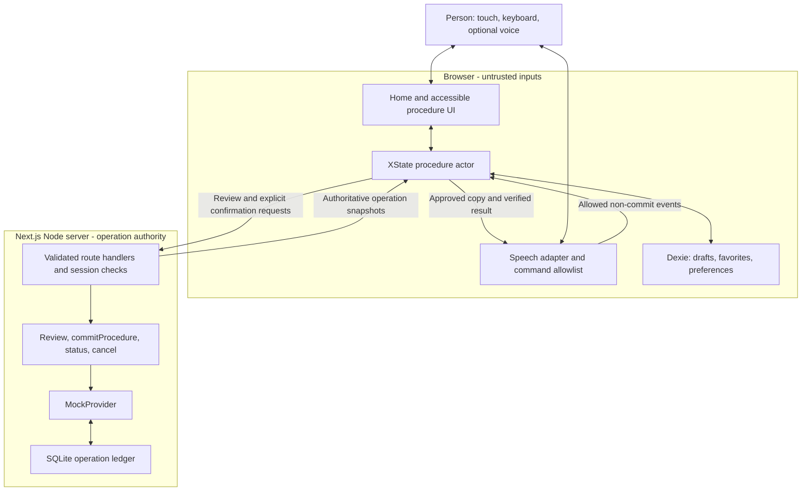

# Autonomía Digital — proposed architecture

Status: **proposed, not implemented**. Date: 2026-10-21.

[Module action plan](ACTION_PLAN.md) · [Product contract](../AGENTS.md) ·
[Product definition](PRODUCT.md) · [Spanish team summary](PRODUCTO_EQUIPO.md)

## Product and observable behavior

Help an older adult complete everyday digital procedures independently, using
clear es-AR text, optional spoken guidance, and recoverable steps. The teammate's
sketches supply the home: large labeled task cards, favorites, visible help, and
a microphone. A task opens a guided journey rather than merely redirecting to
an unfamiliar application.

Internal verification journey, using a simulated provider:

> “¿Qué necesitás hacer?” → “Pagar una factura” → choose service → enter bill
> details → review payee and amount → personally confirm → simulated provider
> result → receipt, with a genuine simulated cancellation path.

The person can ask “¿Qué hago?”, listen to instructions, repeat or slow them,
go back, and resume a saved draft. Every feature remains operable without voice.
The usable-product destination is an authorized, reconciled real utility-bill
payment with support and operational readiness. The mock journey is an internal
verification checkpoint, not that operational release. Other procedures follow
only after the first satisfies the applicable AGENTS.md I1–I10 gates.

This is a design document. The repository currently contains product instructions
and vendored skills, not an application, package manifest, or executable tests.
Dependency versions and browser behavior must be verified during implementation.

## Authority and trust boundaries

Threat model before module layout:

- A caller can edit browser state, local storage, transcripts, URLs, and HTTP
  requests; replay a confirmation; double-click; race another tab; and lose a
  response after the server has committed. Treat all these inputs as untrusted.
- The server owns simulated bill amounts, operation status, authorization,
  idempotency, and cancellation. A client machine, receipt cache, or voice output
  cannot establish that a payment happened.
- The initial deployment assumes a controlled demo server and synthetic bills.
  Host compromise, real financial authorization, and external payment settlement
  are outside that delivery. Demo session isolation still applies from day one.

That initial trust model applies to internal development and safe demonstrations.
Operational release extends it with financial-account authority, provider-bound
authentication, settlement/reconciliation, authenticated callbacks where used,
support, monitoring and privacy controls as specified below. Anonymous demo
sessions do not grant financial authority in that release.

| Crossing | Checkpoint | Failure behavior |
| --- | --- | --- |
| UI/voice → flow | Typed event allowlist and current-state guard | Explain unsupported action; keep the current step |
| IndexedDB → flow | Versioned draft parser and migration | Preserve the original record; offer explicit recovery |
| Browser → server | Bounded schema parsing, same-origin mutation checks, anonymous session ownership | Reject without changing an operation |
| Confirmation → operation | Bind confirmation to server quote, draft revision, session, and idempotency key | Stale/changed details require a new review |
| Server → provider/store | Narrow provider interface and atomic state transitions | Return known status or an unresolved transport error; never infer success |
| Speech adapter → browser/vendor speech service | Capability detection, explicit activation, disclosed processing route | Stop listening/speaking; retain all written controls |

An anonymous opaque session cookie isolates demo users without an account. Use
HttpOnly, SameSite, and Secure on HTTPS deployments; do not use a client-supplied
session ID as identity. Every operation lookup and cancellation checks ownership.
A confirmation token binds a reviewed quote; it is not proof of human identity
or a substitute for authorization in a future live financial integration.

## System shape

Use a **modular Next.js application**, TypeScript, App Router, and a Node server.
The same deployment serves pages and the small procedure API. No separate Python
service, agent framework, queue, vector database, or microservice fleet is needed.



Server Components handle the static shell and initial catalog. Client Components
own the active procedure actor, form interactions, IndexedDB, and speech. Access
browser APIs after hydration; mark provider, ledger, and configuration modules as
server-only. XState owns procedure transitions; form libraries own field editing
and errors, not a second copy of the procedure lifecycle.

## Repositories to combine

Consume focused packages through the package manager; do not merge upstream Git
histories or copy entire repositories. Pin compatible versions and commit the
lockfile when implementing. Preserve required notices when adapting source.

| Repository | Role in this proposal | Reuse mode / license noted during research |
| --- | --- | --- |
| [Next.js](https://github.com/vercel/next.js) | Routing, React rendering, Node API | Framework; exact version chosen and tested in M00 |
| [React Aria](https://github.com/adobe/react-spectrum) | Accessible fields, dialogs, buttons, focus behavior | `react-aria-components`; Apache-2.0 |
| [XState](https://github.com/statelyai/xstate) | Procedure states, guarded events, recovery | `xstate` and React binding; MIT |
| [Zod](https://github.com/colinhacks/zod) | Shared parsed contracts at browser/server/storage boundaries | Package; MIT |
| [React Hook Form](https://github.com/react-hook-form/react-hook-form) | Field validation and editing, if native controlled fields become cumbersome | Optional package; MIT |
| [Dexie](https://github.com/dexie/Dexie.js) | IndexedDB draft, favorite, and preference repository | Package; Apache-2.0 |
| [better-sqlite3](https://github.com/WiseLibs/better-sqlite3) | Durable local simulated-operation ledger | Newly proposed adapter dependency; verify release, license, and native build compatibility in M00 |
| [MSW](https://github.com/mswjs/msw) | Client HTTP timeout/error scenarios | Development/test dependency only; MIT |
| [Playwright](https://github.com/microsoft/playwright) | Browser journeys and restart/recovery checks | Test dependency; Apache-2.0 |
| [axe-core](https://github.com/dequelabs/axe-core) | Automated accessibility checks, via a Playwright integration | Test dependency; MPL-2.0 |

The durable ledger dependency is new to this proposal: Dexie alone cannot make a
server-side operation survive a process restart or enforce cross-tab idempotency.
SQLite is a proposed implementation behind a narrow repository interface, not an
assertion that native modules already work in this environment.

### References and alternatives

| Repository | What to borrow | What stays outside the initial application |
| --- | --- | --- |
| [GOV.UK Frontend](https://github.com/alphagov/govuk-frontend) | Clear questions, error summaries, review and confirmation patterns | UK branding and its entire UI stack; code MIT, documentation separately licensed |
| [Docassemble](https://github.com/jhpyle/docassemble) | Guided interviews, contextual definitions and help | Python/YAML runtime; MIT |
| [Assembly Line](https://github.com/SuffolkLITLab/docassemble-AssemblyLine) | Mobile-friendly procedural questions, review and document delivery | Court-specific content and infrastructure; MIT |
| [AI Senior Assistant](https://github.com/mateo252/AI-Senior-Assistant) | Voice-help interaction ideas for older adults | Windows application, screenshots, Ollama, and browser extension; Apache-2.0 |
| [SurveyJS Form Library](https://github.com/surveyjs/survey-library) | Alternative JSON-driven form renderer | Add only if it wins an evaluated comparison; MIT applies to Form Library, not all SurveyJS products |

These references are design inputs, not claims that the original apps already
satisfy our product requirements. Research inspected documentation/examples and
licenses; integration, dependency security, maintenance, and accessibility are
not yet verified. Do not add SurveyJS alongside another full form engine by default.

## Proposed module layout

Paths below are to create, not files that already exist. Non-route folders inside
`app/` have no `page.tsx`; they organize modules without creating public routes.

```text
app/
├── layout.tsx                         # language, page landmarks, global styles
├── page.tsx                           # home route
├── (flow)/[procedure]/page.tsx         # thin route into the procedure controller
├── api/
│   ├── reviews/route.ts               # validate a simulated bill and issue review
│   └── operations/                    # commit, owned lookup, cancellation routes
├── flows/
│   ├── contracts.ts                   # step/event/result schemas and types
│   ├── registry.ts                    # only implemented procedure definitions
│   ├── procedure-machine.ts          # XState lifecycle and guards
│   └── pago-servicio/                 # bill-specific schema, steps, copy bindings
├── components/
│   ├── ui/                            # cohesive accessible primitives
│   ├── home/                          # task cards, favorites, resume card
│   └── procedure/                     # shell, fields, review, result, receipt
├── lib/
│   ├── copy/es-AR/                    # shared visible/spoken instructions and help
│   ├── money.ts                       # integer minor units and display formatting
│   ├── persistence/                   # Dexie schemas, migrations, storage status
│   └── server/                        # session, boundary parsing, procedure service
├── speech/                            # output/input adapters, capability and intent map
└── providers/
    ├── contracts.ts                   # provider interface, serializable safe results
    ├── mock/                          # deterministic provider, ledger and migrations
    └── server-factory.ts              # fail-closed provider selection
tests/
├── unit/                              # transitions, schemas, money, command allowlist
├── integration/                       # provider ledger, session isolation, recovery
└── e2e/                               # complete journeys, axe and fault scenarios
docs/                                  # this proposal, module plan, later evidence
```

Component boundaries follow behavior and cohesion: `BillField` keeps label,
input, hint, and error together; `HelpPanel` owns its open/focus behavior;
`SpeechControls` owns speech controls. Do not split each HTML element into a file
or place financial rules inside page components.

## Domain contracts and state ownership

| Model | Minimum fields | Authority |
| --- | --- | --- |
| `ProcedureDefinition` | Stable ID, version, steps, primary action, help and back/cancel targets | Domain code; schema-checked |
| `Draft` | Schema version, draft ID, procedure version, step ID, entered values, operation reference/key if any | IndexedDB, parsed on read; not payment evidence |
| `Review` | Server quote ID, payee, synthetic bill ID, ARS amount in integer centavos, draft revision, confirmation binding | Server; client-edited values never set the payable amount |
| `Operation` | ID, owner session, draft/attempt ID, request fingerprint, idempotency key, revision, provider status, cancellation capability | Server ledger |
| `Favorite` | Implemented procedure ID and ordering preference | Local device; no bill/account/card credentials |
| `SpeechPreferences` | Enabled/muted state and chosen rate/voice preference | Local device; no recording or transcript |

Planned step states:

`choosingService → enteringBill → reviewing → confirming → submitting → result`

Recovery adds `restoring`, `reconciling`, and `recoverableError`; cancellation adds
`cancelling` and `cancelled`. Back navigation changes a draft, never an already
committed operation. Editing reviewed data invalidates its confirmation binding.

The three provider outcomes remain `succeeded`, `pending`, and `failed` (I4).
Transport uncertainty is not a fourth invented provider outcome: show “No pudimos
confirmar el estado” and reconcile. `cancelled` describes a verified lifecycle
transition with its own label; it must not remain visually or audibly “pagado”.

### Narrow server API

| Proposed endpoint | Contract |
| --- | --- |
| `POST /api/reviews` | Parse draft/bill identifiers; resolve a synthetic catalog bill; return a server quote and confirmation binding |
| `POST /api/operations` | Call the sole `commitProcedure()` boundary with reviewed binding and stable idempotency key |
| `GET /api/operations/:id` | Return only the owning session's current authoritative result |
| `POST /api/operations/:id/cancel` | Verify ownership/capability/revision; transition atomically and return the current result |
| `GET /api/operations?draftId=...` | Reconcile the owning session's draft after a lost response, even when the client lacks an operation ID |

Route handlers parse and authorize; the procedure service orchestrates; the
provider changes operation state. There is no generic proxy endpoint accepting a
client-selected URL. All mutation requests receive same-origin/CSRF protection;
an opaque operation ID is never sufficient authorization.

### Idempotency, recovery, and cancellation

1. Persist a draft/attempt ID and idempotency key **before** sending a confirmation.
   If this write fails, explain the storage problem and block commit; do not
   silently replace a durable attempt with an untracked request.
2. The ledger enforces unique ownership/draft-attempt and idempotency constraints.
   Repeated identical requests return the same operation; a reused key with
   different details is rejected. Another key cannot bypass the active-attempt
   constraint for the same reviewed bill/draft. A new attempt after a known
   failure requires an explicit retry and another valid confirmation.
3. Validate and commit the simulated operation in a single SQLite transaction.
   Do not separately write “paid” and an idempotency receipt. No real outbound
   payment call takes place in this transaction.
4. A timeout, refresh, or app restart triggers lookup/reconciliation, never an
   automatic new payment. Pending results remain pending until the provider says
   otherwise. A lost session cannot take ownership by presenting a draft ID.
5. The initial mock advertises cancellation for its pending and simulated-paid
   operations until cancelled; no artificial countdown is needed. Cancellation
   changes the persisted operation exactly once. An injected non-cancellable
   scenario must explain the capability limit honestly.

A live provider later requires a separate settlement/reconciliation design;
there is no distributed transaction between SQLite and an external payment API.
Do not transfer the mock's cancellation promise to a real provider.

## Voice and accessible interaction

Start with a `SpeechOutput` adapter around browser speech synthesis and a
`SpeechInput` adapter around feature-detected browser speech recognition. Both
remain candidates until tested on physical target devices. No Python assistant,
LLM, or paid speech account is necessary for the proposed first implementation.

Only user activation starts output or microphone capture. Display listening,
speaking, paused, unavailable, and error states; offer stop, repeat, slower, and
mute. Stop recording on navigation, cancellation, and backgrounding. Browser
recognition may involve a vendor service: disclose the actual supported route
and do not promise offline/private processing without verification.

An allowlisted intent map supports “quiero pagar la luz”, “repetí”, “más despacio”,
and “no entiendo”. Unknown/ambiguous speech asks for a simple selection; it does
not guess amounts, advance a consequential action, or invoke `commitProcedure()`.
Visible/spoken help reads the same copy record. Amounts and receipts are formatted
from validated values; result announcements use the latest provider revision.
Stop stale utterances when a result changes, especially on cancellation.

Use native semantics and React Aria as needed. Keep help in a consistent position,
focus the step heading after navigation, associate errors with fields, and avoid
competing screen-reader/live-region and synthesized-speech announcements. The
project's 44×44 px target is intentionally stricter than WCAG 2.2 AA's general
24×24 px minimum; retain it. Verify 4.5:1 body contrast, keyboard operation, screen
reader behavior, and usable 200% zoom. Automated axe results alone do not prove AA.

## Runtime, persistence, and diagnostics

Proposed baseline: pinned compatible Next.js/React/Node 24 LTS releases, npm with
a committed lockfile, one Node server, and a persistent SQLite file. Verify the
native adapter build first. Browser drafts and server ledger both need migrations.
Ignore generated DB files, logs, recordings, and test outputs at creation; retain
only intentionally authored synthetic catalog definitions and migration source.

Use a writable data directory outside public assets and tracked source. The demo
needs no live payment credentials. A demo-only provider factory rejects live
configuration and never imports a real SDK. Mock scenarios are deterministic
server-owned test fixtures, not arbitrary payment-status overrides in public UI.

A local cloud-development run can use its retained filesystem; a deployed demo
needs HTTPS, a persistent disk, and server-controlled session-secret configuration.
Generate secrets securely at deployment, never in these docs. Ephemeral/serverless
filesystems or multiple independently writing replicas invalidate this deployment
choice; switch the ledger adapter to a shared transactional store before using them.

Keep structured diagnostics to event type, correlation ID, and safe error code.
Do not log bill/customer identifiers, session/confirmation secrets, raw requests,
audio, or transcripts. Disable financial mutation offline, retain the draft, and
provide an explicit reconciliation/retry path after connectivity returns. A full
offline PWA is not assumed; clearing browser data cannot be promised recoverable.

## Operational payment integration and release

The user requires a usable product. The architecture therefore includes this
path now, rather than treating live execution as an optional demonstration
enhancement. It remains **unimplemented and provider-dependent**. No new financial
authorization is inferred from this document; demo mode remains the default.

### Capability investigation before selecting a provider

For each candidate, obtain authoritative documentation and approved sandbox
evidence for bill identification/debt lookup, authorized payer/account access,
actual utility-bill settlement, operation lookup, idempotency semantics,
pending/failure resolution, receipts and cancellation/refund capabilities.
Record onboarding/partnership requirements, fees and unsupported services.

A merchant checkout SDK typically solves payment collection; do not assume it
can settle a user's unrelated utility debt. An external-app handoff may be useful,
but without trustworthy completion evidence it cannot fulfill our payment promise.
If no provider supports the required task, operational release is blocked until
an authorized provider/partnership exists or the product target is explicitly
reconsidered. Do not invent an endpoint to fill this gap.

### Live adapter and financial authority

Keep the domain provider interface; implement a separately enabled live adapter
only after confirming the real protocol. Real user/account authorization must use
the selected provider's supported identity/consent mechanism, with explicit
review of session isolation, token scope/storage/expiry and any step-up approval.
Do not collect a banking password/PIN into our UI or treat an anonymous demo
cookie as financial authority. The onboarding/authentication journey itself must
meet the same clarity/accessibility standards; failure cannot strand the user.

The shared operation model needs separate local request state and external
provider state, with authoritative reference IDs, reconciliation timestamps and
versioned status mapping. Do not expose tokens or secrets in browser bundles,
logs, recorded demos or receipts. Live and demo data/configuration stay isolated.

### Consistency across a network call

SQLite and an external provider cannot share an atomic transaction. Persist an
authorized intent and its stable idempotency/reference before issuing a provider
request. Use the provider's supported idempotency or lookup semantics. A durable
outbox/job/reconciliation mechanism resumes unfinished intents after a crash;
it never creates a new charge merely because a response was lost. If the provider
cannot support safe deduplication/reconciliation, that is a capability blocker.

Where callbacks exist, verify their authenticity and replay protections according
to that provider's actual specification; deduplicate events and reconcile their
ordering/revisions. Bound retry frequency and attempts, then escalate unresolved
operations to owned support. The server ledger maps verified provider facts to
the visible and spoken states; a timeout is not permission to show failure/success.

Adapt cancellation to actual provider capability. If settlement is irreversible,
explain that before confirmation, provide correction before submit and document
the real support/refund path. If this conflicts with a currently required undo
capability, resolve the product/provider gate explicitly; do not claim to satisfy
I2 by hiding the cancellation button or by reusing the mock's behavior.

### Operational gates and observability

Before offering real payments, demonstrate HTTPS and secure provider configuration,
ownership/authorization checks, input bounds and mutation protection, migrations,
durable state, a tested backup/restore and reconciliation drill, status monitoring
and an incident/support runbook with a responsible human. Confirm the selected
host's data persistence and network access. Do not deploy an independent SQLite
file per ephemeral replica.

Proposed provider/environment configuration requirements are documented by name,
never secret value. Actual production configuration and transaction execution are
separate authorized work. Appropriate provider/privacy/legal review must cover
the real jurisdiction and relationship; this proposal is not that review.

User-study metrics can initially be recorded manually in sanitized study records;
no analytics vendor, transcript storage, sensitive event payload or new telemetry
service is required. Developer diagnostics and research observations remain
different data sets. The [evidence ledger](EVIDENCE_LEDGER.md) records the scope
that each can establish.

### ADR-005 — A mock is verification infrastructure, not operational completion

Status: proposed, following the user's explicit usable-product requirement on
2026-10-21. This extends ADR-001/002 and the former simulated-only first-delivery
boundary; it does not replace their authority or persistence requirements.

- **Decision / forces:** retain the safe mock by default, but add provider,
  account-authority, reconciliation and support gates to the real payment release.
  The product must perform its declared task rather than only demonstrate screens.
- **Alternatives:** ship the simulator as if it paid bills (misrepresents completion;
  its strongest argument is safe, repeatable testing); offer only an external link
  (less integration work, but no established completion/control evidence).
- **Assumption:** an authorized provider/partnership can support utility-bill
  execution for the intended jurisdiction and users. This remains unverified.
- **Reversibility / cost:** one-way-ish after provider agreements or real data
  exist; keep provider contracts replaceable and preserve ledger semantics.
- **Revisit trigger:** provider evidence rules out the required task, contradicts
  the undo/confirmation contract, or imposes an inaccessible authorization flow.
  Resolve scope with the owner rather than silently downgrade the product promise.

## Proposed decision records

All records below are **proposed** on 2026-10-21. AGENTS.md remains authoritative
for product rules. Accepted implementation decisions should retain these IDs and
be linked from the corresponding modules; supersede a decision rather than erase it.

### ADR-001 — Keep one modular Next.js deployment

- **Decision / forces:** one TypeScript application; small product surface, existing
  Next.js direction, no existing backend to preserve.
- **Alternatives:** separate frontend/Python Docassemble backend adds deployment
  and contract boundaries; its best argument is an existing interview engine.
  Microservices add operations without independent scaling needs; their best
  argument is team/service isolation.
- **Assumption:** one application team and a single coherent procedure product.
- **Reversibility / cost:** two-way at module boundaries, increasingly costly once
  HTTP contracts spread. Keep domain/provider contracts independent of routes.
- **Revisit trigger:** a required integration needs an independent runtime or
  independently deployed/scaled ownership emerges.

### ADR-002 — Separate device drafts from authoritative operations

- **Decision / forces:** Dexie for drafts/favorites, SQLite behind a server ledger
  interface for simulated payments; refresh and process-restart recovery matter.
- **Alternatives:** client-only results cannot establish server truth; their best
  argument is simplicity. In-memory server state loses committed results on
  restart; its best argument is zero infrastructure. Managed PostgreSQL is valid
  but adds setup; its best argument is durable multi-instance operation.
- **Assumption:** a single Node deployment with persistent disk is available.
- **Reversibility / cost:** one-way-ish after data exists; migrate ledger and
  preserve idempotency/ownership constraints behind the same interface.
- **Revisit trigger:** adapter installation fails on the selected runtime, storage
  is ephemeral, or more than one independently writing instance is required.

### ADR-003 — Use our step UI and one procedure machine

- **Decision / forces:** React Aria + XState + Zod; add React Hook Form only when
  justified. Match the teammate's design and keep one transition authority.
- **Alternative:** SurveyJS offers JSON-driven forms quickly; its best argument
  is mature branching/rendering. It remains an alternative because control over
  step/help/speech behavior and transaction boundaries still needs validation.
- **Assumption:** one payment procedure does not justify a form-builder platform.
- **Reversibility / cost:** two-way initially; more expensive after step rendering
  spreads. Keep definitions separate from JSX.
- **Revisit trigger:** a representative SurveyJS integration meets the same
  accessibility/voice/recovery contract with demonstrably less custom code.

### ADR-004 — Use bounded voice commands and approved spoken copy

- **Decision / forces:** optional browser speech adapters; no free-form AI controls
  payment decisions. es-AR behavior and mobile support remain uncertain.
- **Alternatives:** cloud speech offers more consistent recognition but adds a
  data-processing/vendor decision; that consistency is its best argument. The
  desktop assistant has useful interaction ideas but a mismatched runtime.
- **Assumption:** at least one explicitly supported mobile-browser configuration
  can provide acceptable speech input/output and a complete touch fallback.
- **Reversibility / cost:** two-way through adapters; changing where audio goes
  requires renewed privacy disclosure and validation.
- **Revisit trigger:** physical-device checks fail, es-AR voices are unusable, or
  the selected recognition service's data-processing route cannot be explained.

## Validation and unresolved evidence

The [action plan](ACTION_PLAN.md) maps modules to evidence. Essential experiments
include replay/race/restart tests against the real mock ledger; recovery after a
lost response; cancellation verified by subsequent lookup; and a complete journey
with speech unavailable. Use negative controls that bypass confirmation, delete
idempotency enforcement, or fabricate success to show relevant tests fail.

No application build, test suite, speech device check, or dependency integration
has run for this proposal. Node/package compatibility, speech support and data
processing, hosting persistence, and usability with older adults are open gates,
not established capabilities. Implementation should record actual commands and
outcomes as they become available. The operational provider/account-authority,
reconciliation and support gates are also open. Software checks cannot replace
[user comprehension and transfer observations](VALIDATION.md).

## Repository skills applied

- [secure-by-construction](../.commandcode/skills/secure-by-construction/SKILL.md): authority and threat boundaries before layout; typed contracts and fail-closed mutations.
- [decision-record-discipline](../.commandcode/skills/decision-record-discipline/SKILL.md): alternatives, assumptions, reversibility, and observable revisit triggers.
- [frontend-component-boundaries](../.commandcode/skills/frontend-component-boundaries/SKILL.md): cohesive fields/help/speech behavior rather than ceremonial file splitting.
- [frontend-accessibility-by-construction](../.commandcode/skills/frontend-accessibility-by-construction/SKILL.md): semantics, focus, keyboard behavior and manual verification.
- [non-overwhelming-ux](../.commandcode/skills/non-overwhelming-ux/SKILL.md): consistent help, recoverable steps, controlled speech and no artificial urgency.
- [destination-driven-construction](../.commandcode/skills/destination-driven-construction/SKILL.md): coherent product deliveries with persistence and authority boundaries from the start.
- [falsifiable-testing](../.commandcode/skills/falsifiable-testing/SKILL.md): acceptance evidence that detects violated invariants.
- [git-discipline](../.commandcode/skills/git-discipline/SKILL.md): inspect actual state and retain a restore point; this proposal does not authorize commits or pushes.
